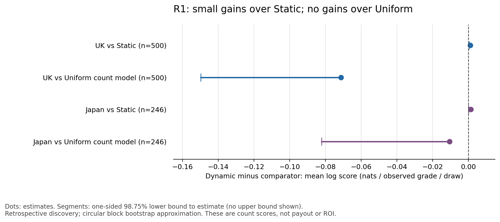

# EV-DYN-DILUTE-R1未通過：動態計數分數略勝靜態，但未勝均勻對照

**R1已封存，不作正EV、未來命中優勢或電腦票比例的聲稱。** UK評分500期、日本246期，兩國的動態模型對靜態模型之差都通過單項計數門檻，但對均勻Random計數模型的平均分數均較低，四項比較沒有全過。原公告時刻及完整歷史獎制仍缺，條件派彩比、校正下界及ROI下界全部NA，沒有用事後派彩報價代替。

## 已鎖範圍、運行與指標

- [預鎖文件](prereg-ev-dyn-dilute-r1.md) commit：`43f1a84ef342f2b789cda00e386877bf691403a2`。
- 實作及雜湊鎖定commit：`338c4922ace20bb1f79137e0081139bbe196f6fd`。正式執行前工作樹乾淨，預鎖是其祖先；參數、程式及輸入雜湊均先核對。
- 這是本地Git預鎖；本次推送在結果完成後，不聲稱預鎖曾在擬合前公開或已有外部可信時間戳。
- 正式運行一次：2026-10-30 **05:19:07.587306–05:19:16.271464 UTC**（13:19:07–13:19:16 HKT），`run_count=1`。沒有改參、換起點、重擬合或重跑；六個NB2擬合全部收斂。
- UK701–900訓練、901–1400評分500期；日本701–900訓練、901–1146評分246期，沒有延長窗口。各模型只擬合最初200期，往後凍結。這是歷史順序評分，**不是每期重估的滾動模型，也不是當年真實前向預測**。
- NB2計數包含零值；四個偏好特徵、收縮、銷量預測及區塊bootstrap均依預鎖。Random計數對照為均勻玩家六碼選票分布及同樣訓練的NB2離散度，不是一次隨機八注的注數結果。
- UK訓練999個有效計數格、1格NA；評分2498格、2格NA。日本訓練1000格；評分1229格、1格NA。各期保留，僅排除缺少的注數格，零值仍計分。派彩NA不被填成0；原有日本兩格銷量NA不回填，評分一律使用凍結的投注前售量模型預測。

## 四項主比較

統計量為每期可比較獎級之平均邊際log probability差，再跨期平均，單位為nats／有效獎級／期；正值代表動態較好。單側區塊bootstrap各10000次、block長10；每比較alpha=.0125，下界為單側98.75% basic下界。校正p為`min(1,4p)`，對照家族alpha=.05。計數通過還須平均差及下界均>0。

| 評分區間／比較 | 平均log-score差 | 單側98.75%下界 | 原p | Bonferroni p | 單項計數通過 |
| --- | ---: | ---: | ---: | ---: | --- |
| UK901–1400：動態−靜態 | +0.001039063 | +0.000524214 | 0.000099990 | 0.000399960 | 是 |
| UK901–1400：動態−Random | −0.071283622 | −0.149773293 | 0.975002500 | 1.000000000 | 否 |
| 日本901–1146：動態−靜態 | +0.001345897 | +0.000173015 | 0.005399460 | 0.021597840 | 是 |
| 日本901–1146：動態−Random | −0.010547355 | −0.082061441 | 0.630736926 | 1.000000000 | 否 |

圖中線段只由單側下界畫至估計值，沒有虛構上界。這些是近似區塊bootstrap的回溯計數比較；平穩／弱依賴條件及先前discovery曝光仍限制推論。小幅優於靜態模型不能替代未勝Random的主對照，也不能換算成經濟收益。

三模型的平均分數，越高越好：

| 國家 | 動態 | 靜態 | 均勻Random |
| --- | ---: | ---: | ---: |
| UK | −7.203149846 | −7.204188909 | −7.131866224 |
| 日本 | −6.518942534 | −6.520288431 | −6.508395178 |

omega在UK評分首末為0.509114→0.506319，日本為0.477955→0.472199。它是受收縮且可與偏好係數混淆的模型混合參數，沒有外部觀察把它識別為實際電腦票份額；不作稀釋機制的支持證據，不移植香港。

## 同期八注、貪婪八注及財務缺口

746個目標期均先寫入模型條件預測函數、凍結參數、售量預測及四個紙上八注配置並fsync，才由broker交付該期球號及採納注數；`scores.jsonl`保存journal位移及內容SHA。當期球號只用作凍結函數的條件計數評分，沒有被當成投注前已知。所有配置及號碼在 [predictions.jsonl](../ev/EV-DYN-DILUTE-R1/run/predictions.jsonl)，各注獎級在 [scores.jsonl](../ev/EV-DYN-DILUTE-R1/run/scores.jsonl)。這些都是外國歷史紙上配置，不是26/116正式預測。

下表單位是**中獎的紙上注數**，不是成功期數／人數／新命中嘗試。UK每配置共4000注，日本1968注；前三獎在本次配置中均為0。

| 國家／配置 | 四級注數 | 五級注數 | 未中獎注數 | 條件派彩比／校正下界／ROI下界 |
| --- | ---: | ---: | ---: | --- |
| UK動態模板 | 1 | 73 | 3926 | NA／NA／NA |
| UK靜態模板 | 1 | 73 | 3926 | NA／NA／NA |
| UK隨機模板 | 7 | 80 | 3913 | NA／NA／NA |
| UK動態貪婪 | 3 | 52 | 3945 | NA／NA／NA |
| 日本動態模板 | 2 | 56 | 1910 | NA／NA／NA |
| 日本靜態模板 | 2 | 56 | 1910 | NA／NA／NA |
| 日本隨機模板 | 2 | 58 | 1908 | NA／NA／NA |
| 日本動態貪婪 | 3 | 63 | 1902 | NA／NA／NA |

動態／靜態模板在UK500/500期、日本246/246期的整個八注配置完全相同。對固定偏好分布加入均勻成分，本身不改變整注冷門次序；本版兩組估計權重也沒有改變模板排序。貪婪配置按預鎖取最低模型擁擠度的八個不同集合，沒有重疊≤2限制，沒有EV最優聲稱。表上注數只作描述，不能取代主指標。

售量預測只用訓練200期的日期／星期與歷史售量擬合。評分期預測全注數範圍為UK約23.79M–38.03M、日本8.00M–9.24M，沒有代入當期實際投注額。**完整獎金分配、滾存、促銷、保底封頂及官方原公告時刻仍未驗收；不能正確結算本方八注加入後的分彩分母、成本及獎池調整。** 因此所有實際財務比率及下界留NA；沒有計算或聲稱本方分彩、保底封頂已被完整處理，沒有以已四捨五入的派彩反推精確獎池。財務通過與正EV均為否／未證，不把「資料不足」當成虧損已證實。

## 合成稀有派彩功效

依預鎖在18格各模擬5000個資料集，seed20261030、PCG64，與真實擬合／獎金獨立。派彩為含大量零值的有限稀有大獎混合，不是實際UK／日本派彩分布估計，也不是無限尾模型。共用事件機率.8，單側paired-t規則alpha=.0125；本節只是該**合成診斷規則**的拒絕率，不是完整實際EV通過功效，更不是主NB計數檢驗的功效。

| 每期稀有大獎機率 | 真期望派彩比 | n500拒絕率 | n246拒絕率 |
| --- | ---: | ---: | ---: |
| .01 | 1.00（型一錯誤診斷） | 0.02% | 0.00% |
| .01 | 1.10 | 3.20% | 0.56% |
| .01 | 1.30 | 5.88% | 0.82% |
| .001 | 1.00／1.10／1.30，各一格 | 各0/5000 | 各0/5000 |
| .0001 | 1.00／1.10／1.30，各一格 | 各0/5000 | 各0/5000 |

10%差異、p=.01時MC標準誤為n500約0.249百分點、n246約0.106百分點。0/5000不代表真功效為0；其二項單側95%上限約0.0599%。完整18格及MC標準誤見 [power.json](../ev/EV-DYN-DILUTE-R1/run/power.json)。本組稀有派彩下，500／246期並不足以讓此診斷規則可靠發現10%均值差異；不能把常態小效應門檻直接延伸到實際厚尾獎金，也不能推論其他未模擬分布的功效。

## 封存、原始證據及限制

R1兩國均未通過完整計數門檻，財務門檻亦不可評估，**封存本版，不重調特徵、收縮、omega形態、窗口或門檻**。沒有因小p值另造新ID或恢復已停用香港族；命中嘗試仍14，EV運行另記 [ledger.json](../ev/EV-DYN-DILUTE-R1/ledger.json)，既有registry未修改。

原始 [results.json](../ev/EV-DYN-DILUTE-R1/run/results.json) SHA-256：`6fcbde15f56677f27307e7ff358d272357ce0965848d29499001e560b195daa3`。預測journal SHA-256：`008c231c22c1fd39c37d4fa526dec0167220819241091ad618279056e36efb3b`。`run/sealed.json`保存全部運行檔指紋；`uk-fits.json`／`japan-fits.json`保留六次擬合、售量模型、收斂訊息及有效格數。

測試以小母體完整枚舉獨立核對加權獎級機率及貪婪八注，另以SciPy NB分布核對零計數、有限差分核對complex-step梯度、驗證先寫後揭示及未來訓練防護。結果驗證只讀封存產物，重新加總log score、NA遮罩、售量預測公式、八注獎級及雜湊；**沒有重擬合、重評彩票或重抽正式MC**。圖只讀封存統計量，另保留來源指紋及繪圖程式。

完整測試profile：**238通過、27項跳過、0失敗**（15.96秒）；27項為既有會讀封存結果的測試，按 `--no-sealed-results` 隔離設定明示跳過。這包含本輪18項檢查；正式結果沒有因驗證而重跑。檢查紀錄見 [validation.json](review-evidence/ev-dyn-dilute-r1/validation.json)。

保護範圍prereg-r2/r3、H3、marksix_data.csv、正式26/116、原EV-1、封存外部窗口、既有registry與tag維持原值。原EV-1的`eligible_for_modeling=false`未改；本輪Manager授權的有限歷史計數研究，沒有補成完整財務資料驗收。沒有當年可核證時序，也沒有將已曝光的discovery窗口重新宣稱為未見資料。
